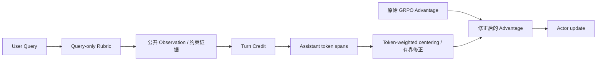

# Agentic-TurnCredit-LongHorizon

**面向多约束购物决策的长程 Agent 后训练系统**

基于 **Qwen3.5-2B、veRL、Ray 与 vLLM**，在 ShopSimulator 中完成
**Baseline → 课程式 SFT → 在线 GRPO → Evaluation**。
针对长程工具交互中 trajectory-level Advantage 粒度过粗的问题，引入
**Query-only Rubric 驱动的 Turn-level Credit Assignment**，为不同 Agent turn
分配细粒度训练信号。

## 实验结果

在固定 **Final-200 Clean** 上，每题一次 rollout；严格成功要求完整
`gold_purchase` 终局结果且 `reward_valid=true`，异常任务仍计入 200 题分母。

| 模型 | Strict Success | Final-200 Strict Success Rate |
|---|---:|---:|
| 原始 Qwen3.5-2B | 2 / 200 | 1.0% |
| 课程式 SFT Stage C | 124 / 200 | 62.0% |
| A：原 GRPO，step500 | 123 / 200 | 61.5% |
| B：Turn Credit GRPO，step500 | 127 / 200 | **63.5%** |

完整训练链路由 **1.0% → 63.5%**；Turn Credit 相比历史 GRPO 基线提升
**2.0 个百分点**，平均环境 Reward **0.489 → 0.534**。
逐题配对中，7 题由失败转为成功，3 题由成功转为失败，净增 4 题。

该比较为单次 B 训练与历史 A 的对照，并非同期多随机种子消融；
McNemar exact p=0.34375，未达到统计显著性。完整链路的主要收益来自 SFT；
B 的 Reward 有效率由 A 的 96.5% 降至 93.5%，仍存在待改进的失败情况。
结果来源：[评测摘要](docs/results/final200.json)、[配对比较](docs/results/paired-comparison.json)、
[逐题结果](docs/results/task-outcomes.jsonl)。

## 训练系统

- **Curriculum SFT：** 复用并校验 1,192 条去重教师购物轨迹，按 A/B/C 三阶段
  递进式 LoRA 微调，每阶段 1 epoch，以上一阶段合并模型初始化下一阶段。
  采用 Assistant-only loss mask 监督回复与工具调用，结合 BF16、SDPA、
  Gradient Checkpointing 和 Gradient Accumulation 支持长轨迹训练。
- **Async Rollout：** 基于 veRL + Ray + vLLM 接入 ShopSimulator，配置
  8 个 Agent worker、12 类购物动作工具；另有不执行环境动作的 `think` schema，
  共 13 个工具 schema。ShopSimulator 是程序化购物环境，没有额外的 LLM user simulator。
- **训练工程：** 利用 ContextVar 隔离并发状态，通过显式会话释放回收环境资源，
  并校验工具动作合法性；结合观察文本预算、FSDP、参数／优化器卸载及
  micro-batch=1 控制开销。本次 B 在 2×H100 上完成 500 次实际优化更新。
- **Runtime Contract：** ShopSimulator Environment v2.1、Reward v3、
  Observation v2、Tool Schema v2。上下文上限为 24,576 token，
  不表示所有轨迹都达到该长度。

## Turn-level Credit Assignment

保留 **Reward v3 与原有 GRPO 框架**，在 Actor update 前修正已有 Advantage。



1. **Query-only Rubric：** 从用户需求提取品类、价格、品牌、型号、功能与规格约束，
   不读取 Gold ASIN 或私有任务答案。
2. **Evidence Tracking：** 根据公开页面 Observation 跟踪
   `unknown / supported / contradicted` 状态，对有效核验、重复操作、
   无效动作及购买决策生成 Turn Credit。
3. **Advantage Correction：** 将信用对齐至 Assistant token spans，
   经 token-weighted centering 与有界增量修正，保持优势增量的 token 加权零和性质。
   环境 Observation token 与 padding 不参与信用修正。
4. **Fallback：** 无有效约束、证据异常或无法完成 token 对齐时，回退至原始 GRPO Advantage。

该零和性质约束的是 Advantage 增量，并不意味着 PPO loss 或梯度保持不变。
当前采用固定规则，Dynamic Rubrics 尚未实现。

实现入口：[train_rubric.py](src/shopping_grpo/training/grpo/train_rubric.py)、
[turn_credit.py](src/shopping_grpo/training/grpo/turn_credit.py)、
[Agent loop](src/shopping_grpo/training/grpo/adapter/agent_loop.py)。

## 数据与隔离

| 数据阶段 | 规模 | 用途 |
|---|---:|---|
| SFT 教师轨迹 | 1,192 条 | 课程式监督微调 |
| SFT 预划分 | 1,073 train / 119 development | 训练与验证 |
| GRPO 任务 | 1,000 train / 50 development | 在线采样、训练与开发验证 |
| Final-200 | 200 题 | 独立最终评测 |

A/B/C 实际有效训练样本分别为 **256 / 799 / 1,069**，阶段间存在课程式复用，
不能相加后当作独立轨迹总量。所有训练与开发池均不与 Final-200 按 task_id 重叠。
发布审计发现 GRPO train 与 SFT 池共享 6 个任务，已在
[GRPO metadata](data/grpo/metadata.json) 中记录；不将其表述为阶段间完全零重叠。
数据与环境版本由 Manifest / SHA-256 固定。

## 多维评测设计

保留 **Rubric Curator → Agent Rollout → Rule Gate → Trajectory Judge**
的评测组件：Curator 提前冻结具有 Query Evidence 的 hard／soft 约束；
Rollout 后以 Rule Gate 检查解析、重复动作、Guard 与上下文异常；
Judge 依据实际可见轨迹和 Event ID 判断需求满足及五维 Process Quality，
隔离 Gold ASIN 与环境奖励。

聚合结果分为 **终局结果、需求满足、过程质量、行为指标**四个面板。
代码包含候选提取、Prompt、证据校验与聚合组件；
**本轮尚无完整双 LLM Judge 评测产物，63.5% 来自环境与代码的严格终局判定。**

相关实现：[Rubric](src/shopping_grpo/evaluation/rubric.py)、
[Judge Prompts](src/shopping_grpo/evaluation/prompts.py)、
[Metrics](src/shopping_grpo/evaluation/metrics.py)、
[Results](src/shopping_grpo/evaluation/results.py)。

## 使用入口

GPU 训练与环境服务使用 Linux；主训练环境为 Python 3.12，
ShopSimulator 使用隔离的 Python 3.10。需要兼容的 NVIDIA Driver 和 GPU，
模型权重需自行准备。

```bash
# 安装训练依赖、准备商品索引与环境
bash scripts/setup.sh

# 在独立终端运行购物环境服务
bash scripts/start_environment.sh

# 预览课程式 SFT 命令；--dry-run 不执行训练或模型合并
bash scripts/sft_curriculum.sh --base-model Qwen/Qwen3.5-2B --dry-run
```

| 阶段 | 入口 |
|---|---|
| Baseline | `scripts/serve_model.sh`、`scripts/baseline.sh` |
| SFT | `scripts/sft_curriculum.sh` |
| GRPO | `scripts/grpo.sh`、`configs/grpo.yaml` |
| 模型导出 | `scripts/export_grpo.sh`、`scripts/merge_lora_adapter.py` |
| Evaluation | `scripts/evaluate.sh`、`scripts/evaluate_shop_benchmark.py` |

GRPO 默认关闭 Turn Credit；B 版本需显式设置
`shopping_turn_credit.enable=true`。本次 B 使用 `strength=0.5`、
`max_turn_delta=0.25`、`trainer.n_gpus_per_node=2`，详细记录见
[训练与评测摘要](docs/results/final200.json)。
LoRA Actor 导出后需与正确底座合并再推理；单独使用导出的 base weights
可能遗漏训练增量。实验结果使用 final step500，而非开发集最优 checkpoint。

## 发布范围与致谢

当前发布代码、运行配置、固定数据与结果摘要；不包含模型权重、完整训练日志、
原始 rollout、测试／CI 与内部技术文档。

感谢 [上游购物 GRPO 项目](https://github.com/YYHDBL/shopping-grpo-longhorizon)、
[ShopSimulator](https://github.com/ShopAgent-Team/ShopSimulator)、
[veRL](https://github.com/verl-project/verl)、[vLLM](https://github.com/vllm-project/vllm)
与 [Qwen](https://github.com/QwenLM)。上游代码、数据及模型保留各自权利，
本项目不为继承内容赋予新的统一许可证，详见 [NOTICE](NOTICE)。
